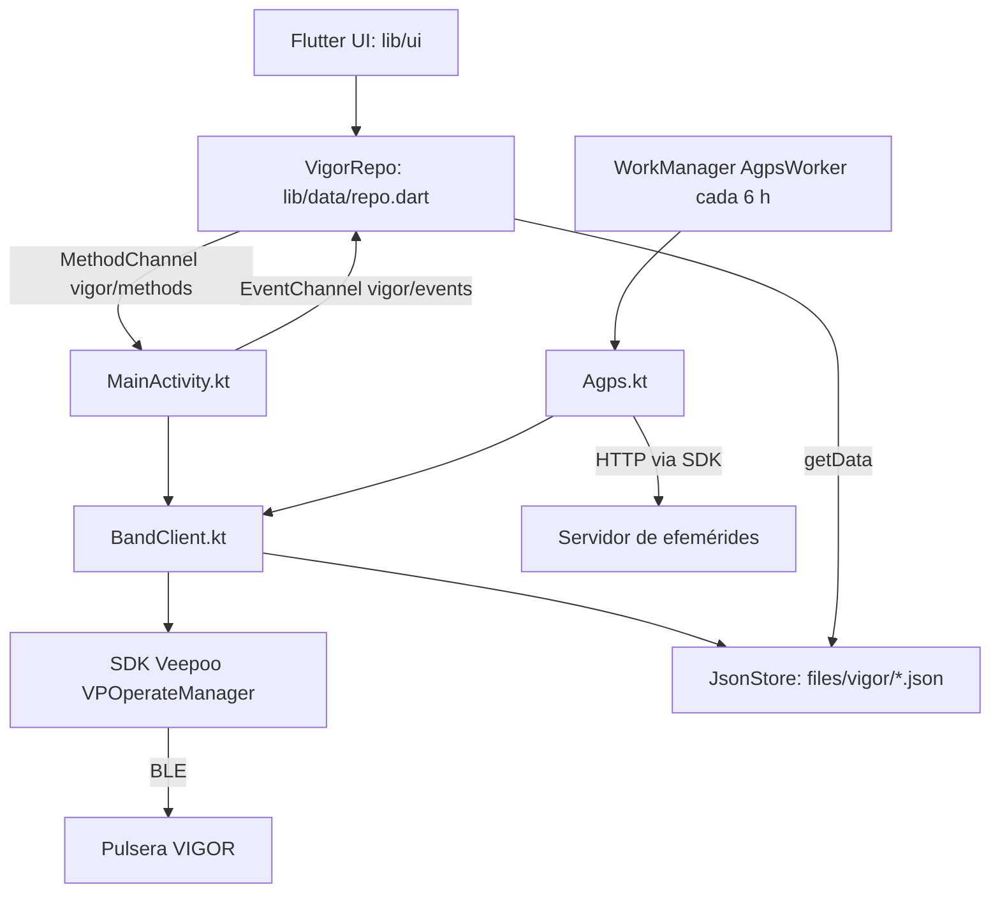

# Arquitectura

Describe lo que se puede comprobar en el código (`lib/`, `android/.../kotlin/`) y en [ESTADO.md](ESTADO.md). Lo no comprobado se marca "no verificado".

## 1. Capas

- **BandClient** es el único punto que toca el SDK; lo usan la app (MainActivity) y el trabajo de fondo (AgpsWorker). Todo el SDK se usa en el hilo principal (los callbacks de conexión, clave y funciones pasan por `onMain`; la lectura de sueño salta a `readOrigin` con `main.post`).
- **VigorRepo** (`ChangeNotifier`) lee los JSON, construye el modelo y notifica a la interfaz.

## 2. Canal de métodos `vigor/methods`
`requestPermissions` (arg `scan`), `startScan`, `stopScan`, `connect` (`mac`, `pwd`; guarda la MAC en preferencias `vigor/mac`), `disconnect`, `savedMac`, `forgetMac`, `sync`, `getData` (`kind`; lee en un ejecutor de fondo y responde en el hilo principal), `startSport` (`type`, por defecto `OUTDOOR_RUNNING`), `stopSport`, `sportState`, `findBand`, `getPrefs`, `setPref` (`key`, `value` entero), `agpsStatus`, `isConnected`, **`exportData`** (copia los `*.json` de `files/vigor` a `getExternalFilesDir/export`; devuelve ruta y lista de nombres; error `EXPORT` si no hay almacenamiento externo o falla) y **`wipeData`** (borra el almacén, `files/agps`, `files/debug` y la carpeta de exportación, y limpia las preferencias `agps`; devuelve el nº de ficheros; error `BUSY` si hay sincronización en curso, `WIPE` si falla). Ambos corren en el ejecutor de fondo y responden en el hilo principal. No tocan `vigor` (MAC) ni `vigor_prefs` (edad, meta, `exp`).
Solo depuración (el lado Kotlin devuelve `false`/0 y no hace nada si la app no es depurable): `debugEnabled`, `debugSleepDump`, `debugProbe` (`kind`: pressure, met, temp, hrv), `debugClearDumps`. Cualquier otro método devuelve "no implementado"; una excepción del SDK devuelve error `SDK`.

Permisos: Android ≥ 12 pide `BLUETOOTH_SCAN` (con `neverForLocation`) + `BLUETOOTH_CONNECT` (solo `BLUETOOTH_CONNECT` si no se escanea); en versiones anteriores, ubicación fina solo para escanear. El manifiesto declara además INTERNET y ubicación gruesa/fina. **PermissionQueue** (`Pure.kt`, DEV_003 K3; antes M7): varias peticiones de permiso simultáneas se encolan. `add` devuelve los permisos a pedir ya al sistema o `null` (si ya hay una petición en curso o no falta nada); `onResult` (llamado desde `onRequestPermissionsResult`, código 77) devuelve las peticiones resueltas y, si procede, la **siguiente ronda**: lo que una petición necesita y la anterior no preguntó (p. ej. `BLUETOOTH_SCAN`) se pide en la ronda siguiente. Una petición se resuelve `true` si tiene todo concedido y `false` si ya se preguntó por todo lo que le faltaba y no se concedió (sin bucle). Se comprueba cada permiso con `checkSelfPermission`; un resultado vacío (petición cancelada) no cuenta como concedido. Probada en JVM; **no** con la Activity ni con un diálogo real. **Tiempo máximo (DEV_004 H3):** `MainActivity.askPermissions` arma con un `Handler` un temporizador de **60 s** (`PermissionQueue.TIMEOUT_MS`); si el sistema no responde, `expire(gen)` resuelve todo lo pendiente (`true` si ya tiene todos los permisos, si no `false`) y libera la cola. Cada ronda lleva un número (`generation`): el temporizador de una ronda antigua no toca la nueva. Para la carrera «no falta nada dentro de `add`», el resultado se guarda y se entrega con `drainLate()`, que `MainActivity` llama justo después de `add`; una respuesta tardía del sistema tras el tiempo máximo es inocua. `PermissionQueue` tiene 10 tests JVM (6 + 4 nuevos de DEV_004; `PureTest` suma 13); el temporizador de 60 s **no está verificado en el móvil**, solo en JVM.

## 3. Canal de eventos `vigor/events`
Mapas con `type`:
| type | campos | efecto en VigorRepo |
|---|---|---|
| `scan` | name, mac, rssi | lista de pulseras encontradas |
| `state` | value: scanning, idle, connecting, connected, disconnected | estado de conexión |
| `battery` | percent, charging | batería |
| `sync` | value: start / end | indicador; al terminar recarga los datos |
| `syncProgress` | value (0–1) | progreso de lectura |
| `sport` | msg | mensajes de actividad/buscar pulsera |
| `log` | msg | registro técnico (máx. 200) |

El `scan` incluye además `macMasked`. Los eventos llegan al hilo principal (`emit` publica con `main.post`). `BandClient.listener` se fija en `onListen` y se limpia en `onCancel` solo si sigue siendo el suyo; no captura la Activity. En Dart, `_onEvent` tiene guardas y `try/catch`.

## 4. Conexión por MAC guardada (sin escaneo)
1. `VigorRepo.init` lee `savedMac`; si existe, llama a `connectSaved` (pide permiso de conexión y envía `connect` con contraseña `0000`). `init` siempre llega a `connectSaved`, aunque falle otra lectura.
2. `BandClient.connect` comprueba `BLUETOOTH_CONNECT` (Android ≥ 12), marca "conectando", guarda un temporizador cancelable de 45 s (se cancela al conectar o fallar) y llama a `connectDevice(mac)` dentro de `try/catch`; al activar notificaciones confirma la contraseña (`confirmDevicePwd`).
3. **Listener de estado:** `registerConnectStatusListener(mac, …)` detecta `STATUS_DISCONNECTED`: pone `connected=false`, aborta la sincronización en curso y emite `disconnected`. Ignora eventos de otra MAC y un desconectado en los primeros 3 s del intento (lo cubre el límite de 45 s); una caída con la conexión ya establecida sí cierra. **No verificado:** una caída real de la conexión no se provocó en el móvil.
4. Si la contraseña falla o hay tiempo agotado, se desconecta. Al verificar: estado `connected` y, si `autoSync`, sincroniza a los 1,5 s y después intenta `Agps.onConnected()`.
5. El escaneo solo se usa la primera vez (pide permisos de escaneo/ubicación).
6. Trabajo de fondo: `runSessionBlocking` devuelve `DONE`, `TIMEOUT` o `NO_SESSION`. Reutiliza la sesión abierta o conecta con la MAC guardada (sin sincronizar). Solo desconecta al terminar si la sesión la abrió **esa** llamada y la app no la reclamó (`connect`/`sync` de la app anulan la marca). Si el hilo se interrumpe, restaura el flag y devuelve `TIMEOUT` (el Worker pide reintento).

## 5. Sincronización (`syncAll`)
No se ejecuta si no hay conexión o ya hay una sincronización. Etapas encadenadas, cada una con tiempo máximo (si vence se registra y se sigue; un vencimiento de lectura vuelca el almacén):
1. **batería** (15 s) → 2. **pasos del día** (15 s; guarda `live/today` con marca de hora) → 3. **salud** (180 s): sueño, luego datos de origen (5 min, medias de 30 min, HRV, SpO₂) con `watchday` días (3 por defecto, o el que informe la pulsera) → 4. **deportes** (180 s): cabeceras y puntos por actividad.
Al terminar emite `sync end` y la interfaz recarga. Una caída de conexión durante la sincronización la aborta (§4).

## 6. Almacén JsonStore
Un fichero `files/vigor/<tipo>.json` por tipo (clave → objeto, con `_key`). Escribir por clave sobrescribe, así que resincronizar no duplica.
| tipo | clave | contenido |
|---|---|---|
| `origin5` | `AAAA-MM-DD HH:mm` (de `mTime`) | datos de 5 min: pulso (`ppgs`), pasos, calorías, distancia, MET, estrés, temperaturas, glucosa, componentes |
| `half` | fecha | medias de 30 min |
| `hrv` | hora | intervalos RR (`rrValue`) |
| `spo2` | hora | `oxygenValue` |
| `sleep` | fecha de la noche | datos de sueño del SDK |
| `sports` | hora de inicio | cabecera de actividad |
| `sportItems` | hora de inicio de su cabecera | `items` (puntos); se reinician al primer lote de cada sincronización y luego se acumulan |
| `live` | `today` | pasos del momento de leer |

Garantías (código de `JsonStore.kt`; cubiertas por `JsonStoreTest`, 14 pruebas JVM con directorio temporal y reloj inyectado):
- **Escritura atómica:** `flush` escribe a un `.tmp`, hace `fsync` y renombra con comprobación. La serialización va bajo cerrojo y la escritura fuera de él, en un hilo de E/S (`ioFlush`), no en el hilo principal.
- **Corrupción:** solo un `JSONException` renombra el fichero a `<tipo>.corrupt-<marca de tiempo>` y empieza vacío; los `.corrupt-*` de más de 30 días se purgan al abrir. Un error de E/S al leer **no** se trata como corrupción: no renombra, no cachea y `flush` se niega a sobrescribir.
- **Retención:** 60 días en `origin5`, `hrv`, `spo2`, `half` y `live`; la referencia es `min(reloj, dato más reciente)` (un reloj adelantado no borra datos).
- **Topes de entradas:** `sports` 500, `sportItems` 500, `sleep` 400.
- **Exportar** (`exportTo`): vuelca a disco lo que haya en memoria, **borra y recrea** la carpeta destino (H4: no quedan copias de tipos que ya no existan) y copia solo los `<tipo>.json` (no `.tmp` ni `.corrupt-*`); devuelve los nombres ordenados. Solo local. `MainActivity` usa como destino `files/export` (privada) y la entrega por el selector de compartir (ver «Exportar y borrar» en la sección de interfaz).
- **Lista blanca de tipos (H7):** `JsonStore.KINDS` = `origin5`, `hrv`, `spo2`, `half`, `live`, `sleep`, `sports`, `sportItems`. `load` lanza `IllegalArgumentException` con cualquier otro valor (también con rutas; `getData` lo convierte en error `STORE`) y `flush` devuelve `false`.
- **Carrera borrado/escritura (H1):** el almacén lleva una generación (`gen`, sube en cada borrado) y un estado `wiping`. `flush` captura `gen` al serializar y, ya dentro del cerrojo de escritura, descarta la escritura si `gen` cambió; mientras `wiping` es `true`, los `flush` se niegan. `tryWipe(canStart)` evalúa `canStart` **dentro** del cerrojo del almacén y devuelve `null` si se niega. `MainActivity.wipeData` hace la comprobación `!isSyncing` dentro de `tryWipe`, y `BandClient.syncAll` comprueba `wiping` y marca «sincronizando» bajo el mismo cerrojo (`synchronized(store)`): no empieza una sincronización durante el borrado ni se borra a medias una que arranca. El error `BUSY` se mantiene. La carrera se prueba de forma determinista con un hook (`beforeWrite`), **no** con hilos reales.
- **Borrar** (`wipe`/`tryWipe`): vacía la caché y borra **todos** los ficheros de `files/vigor` (json, tmp y corrupt) y devuelve cuántos. `MainActivity.wipeData` añade `files/agps`, `files/debug`, la carpeta `files/export` (y la antigua carpeta externa `export`, si existiera) y las preferencias `agps`. Errores del canal: `BUSY` (sincronizando), `WIPE`, `STORE`, `EXPORT`. En Dart, `VigorRepo.wipeData` reinicia días, noches, sesiones, registro y estado de efemérides en memoria y deja el mensaje "Datos borrados de este móvil."; `exportData` muestra «Se abrió el selector de compartir con N ficheros. Lo que elijas allí queda fuera del control de Vigor.» (o «No hay datos guardados que exportar.»; si falla, «No se pudo exportar los datos.»).
Preferencias: `vigor` (MAC), `vigor_prefs` (edad, meta de pasos, `exp` = métricas experimentales 0/1), `agps` (ver §7).
**No verificado en el móvil:** retención, corrupción, `.corrupt-*`, exportar y borrar (sí cubiertos por tests JVM). Sí se vio que los JSON se reescriben sin `.tmp` residuales.

## 7. Efemérides GPS (AGPS)
- `Agps.schedule` (al abrir la app) encola un trabajo periódico único `agps` cada 6 h, con red; política KEEP.
- `downloadIfDue`: si ya hay fichero válido descargado hace menos de 20 h no descarga. La descarga es `@Synchronized` (cerrojo), con fichero temporal único, tiempo máximo de 120 s y comprobación de integridad (> 1000 bytes y que no sea HTML/JSON/mensaje de error); antes de cada descarga se borran los `vp_agps.*.tmp` huérfanos. Marca "pendiente".
- `transfer`: lee batería; **si < 30 % pospone**. Comprueba que la pulsera lo soporte y envía con `startSetUiStream(A_GPS)`, una transferencia a la vez, con tiempo máximo de 200 s; cierra el stream y llama a `done` una sola vez. Éxito → `transferredAt`; fallo → `lastError`. Si la pulsera no lo admite: guarda el motivo y espera 24 h (`nextTryAt`, *backoff*).
- `AgpsWorker` devuelve un `Result` de WorkManager según el resultado: éxito, reintento (`retry`, p. ej. sin sesión o tiempo agotado) o fallo. Descarga si toca y, si hay pendiente, abre sesión (hasta 240 s) y transfiere. Con la app abierta, `onConnected` (ejecutor único, sin hilos sueltos) transfiere lo pendiente solo si la descarga terminó bien.
- Las reglas puras (`AgpsRules` en `Pure.kt`: `looksValid` —tamaño mínimo 1000 bytes y que no empiece por `<`, `{`, `[`, `error` ni contenga "not found"—, `inBackoff`, `nextTryAfterUnsupported` = +24 h, `shouldRetry` con 3 intentos máximo, `isFresh` = 20 h) se probaron en JVM (`PureTest`); `Agps` delegan en ellas.
- `status()` muestra siempre `lastError` (antes se ocultaba sin envío pendiente); se borra tras una descarga o transferencia con éxito o al borrar los datos. En pantalla: "Último aviso: …".
- Los `Log.i/Log.w` de Agps solo salen en compilaciones depurables.
- Verificado con la pulsera real: descarga y transferencia con la app abierta (ronda 1). **No verificado:** ejecución con la app cerrada, el *backoff* de 24 h y el reintento del Worker.

## 8. Modelo de datos y parseo seguro (`lib/data/repo.dart`)
- `Sample(t, v)`.
- `Day`: fecha, pasos, kcal, km y listas ordenadas `hr`, `spo2`, `hrv`, `met`, `stress`, `temp`, `skin`, `glucose`, `steps5`, `blood`, más `q` (mapa de `Quality` por métrica; `qOf`).
- `Night`: fecha, total, profundo, ligero, despertares, hora de acostarse y de levantarse. Solo noches con total > 0.
- `Session`: clave, inicio, tipo, segundos, metros, kcal (calorías/1000), pasos, pulso medio, ritmo, `hasGps`, ruta (con cortes `NaN` en tramos sin señal) y pulso por minuto.
- **Parseo seguro:** lectura de tipos tolerante (`_t` valida rangos y descarta un mapa vacío), `try/catch` por registro (un registro malo no aborta la carga), `getData` ilegible → lista vacía, sesión sin hora de inicio descartada, día basura por `mTime` vacío descartado, `liveSteps` solo si su marca es de hoy, cada lectura de `ppgs` se asigna al día de su propia hora, JSON de más de 100 000 caracteres se decodifica con `compute()`.
- **Centinela HRV:** en `hrv.json`, `rrValue` = 2550 ms significa "sin dato" (medido: 1 348 de 5 050 RR, 26,7 %, en un móvil; ver §9).
- **Filtros de validez** (propios; ver ANALISIS §14): pulso 30–220; SpO₂ 70–100; estrés 1–100; temperatura 30–43 °C, piel 15–43 °C; glucosa > 0. En calidad de datos, 0, 255 y no numérico son "sin dato" y no cuentan como fuera de rango; SpO₂ también cuenta las > 100. Tres estados en la tesela: sin registros → "Sin datos"; registros pero ninguno válido → "Sin datos suficientes"; con valores → la cifra. HRV: ver §9.
- Deportes: **el tipo no se traduce a nombre** en la interfaz ("Actividad deportiva") porque los códigos no están verificados; `sportName()` sigue en `repo.dart` pero no se muestra.
- Edad por defecto 35 (válida 10–100; `ageIsDefault` activa avisos en Hoy, Actividad y sesión); meta de pasos 8000 (1000–40000, pasos de 500). Preferencia `exp` (métricas experimentales) apagada de serie.

## 9. Cálculos (`lib/data/analysis.dart`)
Clásicos: `hrMaxTanaka` (208 − 0,7·edad), `hrZone`, `zoneMinutes`, `edwardsTrimp`, `rmssd` (versión simple, se conserva por sus tests), `median`, `restingHrApprox` (media del 10 % más bajo; respaldo), `haversine`.
Ronda 3 (especificación `docs/equipo/ESPECIFICACION_RONDA3.md`; todos rotulados "aprox." y con umbrales propios):
| Módulo | Qué hace | Reglas en código |
|---|---|---|
| **Calidad de datos (E1)** `Quality`, `coverageText`, `possibleSamples` | por día y métrica: lecturas presentes, válidas, sin dato (0/255), fuera de rango (bajo/alto) y cobertura | posibles = 1 440 (pulso, SpO₂, HRV) o 288 (resto, por 5 min) en días pasados; hoy, las transcurridas. Punto de aviso si hay datos y cobertura < 20 %: "Pocos datos hoy" solo en el día del reloj del repositorio y "Pocos datos este día" en días pasados; SpO₂ y HRV **no** lo activan (se miden por tandas; su cobertura sigue en el pie del detalle) |
| **FC en reposo nocturna (E2)** `restingHrNight` | mediana de las 30 lecturas más bajas de la noche | noche = 00:00–06:00; mínimo 60 lecturas válidas (30–220) |
| **HRV nocturna (E3)** `rmssdMinute`, `isRrSentinel`, `hrvNight`, `meanCv` | RMSSD robusto por registro (1 por minuto de reloj) y mediana nocturna; media semanal y CV | **Centinela:** RR = 2550 ms (también 0 o no numérico) es "sin dato": ni cuenta como par ni como corrección, y un registro todo-centinela (`MinuteHrv.noData`) no cuenta como registro de la noche. RR reales fuera de 300–2000 ms y diferencias > 20 % del RR anterior cuentan como corregidas; ≥ 5 diferencias por registro; noche con ≥ 30 registros válidos y ≥ 60 % de los registros con dato; "Calidad baja" si > 5 % de los pares de RR reales se corrigieron. Si falla: "Sin datos suficientes: n de 30 lecturas" o "…n de N registros válidos (mínimo 60 %)" |
| **Ventana ultracorta** | cada registro de `hrv` trae ≈ 10 RR (≈ 9–10 s), una vez por minuto: **no** es un minuto continuo | el RMSSD es de ventana ultracorta (≈ 9 diferencias) y "30 minutos" = 30 mediciones. `rate` = RR/10, no bpm: no se usa. `hrvValue` del fabricante no se usa. Nota visible en la tarjeta (`hrvSampleText`) |
| **Línea base de 30 días** `nightBaseline`, `nightBase`/`nightHistory` | mediana de las hasta 14 noches válidas más recientes **dentro de los 30 días naturales anteriores** a la noche (`kBaselineWindowDays` = 30; −30 d entra, −31 no) | mínimo 7 noches (`kBaselineMinNights`); menos → "Aún sin línea base: k de 7 noches" |
| **Noche en curso** `VigorRepo.nightInProgress` | el día de hoy antes de las 06:00 | la tarjeta (y su Semantics) dice "Noche en curso: el dato puede cambiar hasta las 06:00 y no entra en la línea base"; las teselas Pulso/HRV añaden "(en curso)"; esa noche sale del historial, del gráfico y de la media semanal |
| **Minutos de actividad (E4)** `weeklyMvpa` | semana lunes–domingo; A por MET ≥ 3 (5 min por registro), B por pulso ≥ 70 % de FCmáx (`kMvpaHrFraction`, umbral propio) | dos cifras separadas, sin fusionar; días con < 70 % de registros se anotan "Faltan datos"; no cuentan como 0; sin "meta cumplida" |
| **Sesión ampliada (E5)** `deriveSession` | ritmo y velocidad calculados con distancia y tiempo de la pulsera | aviso si el ritmo calculado difiere > 5 % del de la pulsera |
| **Decodificador de sueño** `decodeSleepLineNormal` | modo normal: "0" ligero, "1" profundo, "2" despierto, 5 min por carácter | solo con test del ejemplo del SDK; sin datos reales de noche |
**Sesiones:** las calorías de una sesión con `calories` = 0 se muestran "—" (en los datos reales las 4 sesiones traían 0); `sportTime` está en segundos (comprobado con inicio, fin y pausa de 3 sesiones). `rmssd()` antiguo y el RMSSD diario: el RMSSD diario usa ahora el algoritmo robusto ("todo el día, aprox."). Fuentes: [ANALISIS.md](ANALISIS.md). Tests: `test/` (183 en total según DEV_004; ver §15).

## 10. Herramientas de depuración (E6/E7, solo debug)
`DebugTools.kt` **no hace nada en release** (lo comprueba `BandClient.debuggable`); Flutter además solo muestra "Dispositivo → Avanzado (depuración)" con `kDebugMode`. Sin UI pública de sueño nueva.
- **Volcado de sueño (E6):** escribe `files/debug/sleep_dump_<ms>.json` (directorio privado) con la respuesta cruda de `readSleepData` y `readSleepDataSingleDay(0..2)`, los registros `origin5` de 21:00 a 11:00 y los de `hrv`. Sin MAC. "Borrar volcados" los elimina.
- **Sondeo de medición rápida (E7):** `startDetectPressure/Met/Tempture/Hrv` (HRV solo si `isSupportHrvAppDetect`); tope de 60 s, siempre llama a `stopDetect*`, se omite si hay sincronización en curso; resultado y duración al registro técnico.
- **No probadas con la pulsera** (móvil bloqueado). Compilan y la app arranca.

## 11. Privacidad
- **Copia de seguridad:** `allowBackup="false"`; `backup_rules.xml` (copia completa antigua) y `data_extraction_rules.xml` (nube y transferencia entre dispositivos) excluyen los dominios `root`, `file`, `database`, `sharedpref` y `external`. El manifiesto usa `tools:replace` porque el AAR del SDK declara `allowBackup=true`.
- **Registro del sistema:** `BandClient.log` escribe en logcat (`VIGORLOG`) solo si la app es depurable; los objetos del SDK (contraseña, funciones, paquetes) se sustituyen por resúmenes cortos. El registro técnico de la pantalla recibe mensajes cortos sin datos de salud.
- **MAC enmascarada:** `maskMac` (Kotlin y Dart) deja solo los dos últimos bytes, en pantalla y en logs. La MAC completa se guarda en preferencias privadas para reconectar.
- **Exportar y borrar** (Dispositivo → "Privacidad y datos", `PrivacyPanel`, ahora `StatefulWidget`): exportar crea una copia en `filesDir/export` (**privada**; ya **no** hay carpeta en `Android/data` accesible por USB) y la entrega con el **selector de compartir de Android** (`Intent.createChooser` titulado «Guardar o enviar mis datos»; `ACTION_SEND`, o `ACTION_SEND_MULTIPLE` con varios ficheros; tipo `application/json`; `FLAG_GRANT_READ_URI_PERMISSION` y `ClipData`). Los URI los da un **`FileProvider`** declarado en el manifiesto (`${applicationId}.fileprovider`, `exported=false`, `grantUriPermissions=true`) con `res/xml/file_paths.xml`, que solo expone `export/` (`<files-path name="export" path="export/"/>`). **El destino que elija el usuario queda fuera del control de la app**: la app destino puede conservar o leer la copia, y Vigor no puede borrarla. La copia privada se borra con el método de canal **`clearExport`** (sin argumentos; errores `EXPORT`), que Dart llama en `initState` de `PrivacyPanel` (al abrir la pantalla), y también al arrancar el motor (`configureFlutterEngine`), en la siguiente exportación (se regenera) y en «Borrar todos». Tras compartir **no** se borra de inmediato: no hay forma fiable de saber cuándo la app destino terminó de leer. Sin permisos de almacenamiento nuevos. Borrar pide confirmación (el diálogo menciona la copia temporal y que no alcanza las copias ya guardadas fuera de Vigor) y se desactiva durante una sincronización (Kotlin también se niega). Borrar **no** quita la MAC emparejada ni edad/meta. Nada de esto usa internet. Semantics: botones con nombre y el mensaje de resultado como región viva. **No verificado en el móvil:** selector real, lectura por la app destino y borrado de la copia al reabrir; sí se vio con `dumpsys package` que la autoridad del `FileProvider` está registrada (API 29).
- Manifiesto fusionado (DEV_003): ubicación fina/gruesa con `maxSdkVersion=30`, `WRITE_EXTERNAL_STORAGE` hasta 28 y `READ_EXTERNAL_STORAGE` hasta 32 (las traían las librerías del SDK sin tope).
- Receptores exportados (DEV_004 H8): solo el `PendingIntentReceiver` de Nordic Scanner se marcó `android:exported="false"` (`tools:node="merge"` + `tools:replace="android:exported"`; hizo falta el `replace` o la fusión falla), porque solo lo usa el sistema por `PendingIntent`. No se tocaron `SystemJobService` (WorkManager), `DiagnosticsReceiver` ni `ProfileInstallReceiver`. **No verificado en ejecución** que el escaneo de Nordic no se use (la app escanea con el SDK de Veepoo). El manifiesto fusionado mostró ambos componentes con `exported=false` (build de depuración).
- Estrés: la tesela de Hoy muestra el rótulo visible «índice del fabricante · aprox.» y su etiqueta de accesibilidad dice «índice del fabricante, aproximado». No verificado en pantalla.
- Pendiente de build (usuario): 2 `TODO` de `android/app/build.gradle.kts`: `applicationId` y firma de release (hoy con claves de depuración). Hay que resolverlos antes de distribuir.
- Los datos viven en `files/vigor` (privado). Única conexión a internet vista: la descarga de efemérides con el SDK; no se verificó qué datos incluye la petición.
- **No verificado en el móvil:** el efecto real de las reglas de copia.

## 12. Accesibilidad implementada
Hecho en código (DEV_001/DEV_002), **sin probar con TalkBack, escala de texto ni contraste** en el móvil:
- `Semantics` con etiqueta completa en teselas, cinta de días, cifras de pasos/pulso, tarjetas nocturnas, tarjeta semanal, pie de cobertura y punto de aviso.
- El reloj del día es un control ajustable (aumentar/disminuir por franjas de 30 min) y hay un botón **"Ver datos del día por franjas"** que abre una hoja con una fila por hora.
- Los gráficos exponen un resumen (`describeSeries`: mínimo, media, máximo y unidad; los de noches, "N noches con dato: de X a Y").
- Respeta "reducir animaciones" (cifras, Aurora, corazón, cambio de pestaña, cinta de días). El arrastre del reloj reconstruye solo el reloj (`ValueNotifier`).
Lo que no se hizo está en `GUIA_DE_ESTILOS.md` §7.

## 13. Decisiones de diseño y motivos
| Decisión | Motivo |
|---|---|
| Conectar por MAC guardada | evita escanear (y pedir ubicación) en cada uso |
| RMSSD propio desde RR, robusto por minuto | el `hrvValue` del fabricante no coincide con RMSSD ni SDNN (ESTADO.md); filtros de calidad según la bibliografía (ANALISIS §3, §14) |
| Almacén JSON por tipo con clave, atómico | simple, sin duplicados al resincronizar y sin perder datos si se corta la escritura |
| Un solo `BandClient`, todo el SDK en el hilo principal | el SDK se usa desde un único sitio |
| Efemérides en segundo plano y sin avisos | la pulsera necesita el fichero para el GPS; no se molesta al usuario |
| Sin puntuación de sueño ni alertas | las fuentes muestran baja fiabilidad en fases (ANALISIS §5) |
| Glucosa/componentes ocultos de serie, "Experimental", sin rangos | FDA: ningún reloj validado sin pinchar (ANALISIS §12) |
| Minutos de actividad: dos cifras separadas | el MET de la pulsera no está validado; el umbral por pulso es propio |
| Ruta GPS cortada sin fix, sin suavizado | evita rectas falsas (ANALISIS §8) |
| Tema oscuro forzado (`ThemeMode.dark`) | decisión de la interfaz Aurora; el claro apenas se ha revisado |

## 14. Limitaciones conocidas
- HRV: cada medición trae ≈ 10 latidos una vez por minuto y ~27 % de los RR son centinela 2550 en los datos de un móvil; la calidad de la señal puede variar con otra pulsera o persona. El supuesto de 1 lectura/min en `ppgs` es solo "consistente", no probado.
- Sueño sin datos reales verificados (campos tomados de la documentación del SDK; la codificación de `sleepStates` no está decodificada). Herramienta de volcado lista, sin ejecutar.
- Calorías de 5 min: se asumen kcal (no verificado). Verificado contra la app oficial (jefe de proyecto): distancia en metros, calorías de sesión = `calories`/1000 y ritmo en s/km; **no** verificados velocidad, cadencia ni pausas.
- Pantallas nuevas (incluida Privacidad y datos), exportar con el selector de compartir real, borrar real, permisos con diálogo real y su tiempo máximo de 60 s, TalkBack, caída de conexión, Worker con la app cerrada, *backoff*, retención/corrupción: no verificados en el móvil (en la ronda 5 estaba bloqueado).
- Sin pruebas JVM de `BandClient` (SDK/Handler), el Worker, la conexión ni la Activity; M2/N1–N4 de DEV_002 siguen verificados solo por lectura.
- Solo una app a la vez por BLE; contraseña fija `0000`.
- Sin: alarmas, notificaciones del móvil a la pulsera, cámara remota, calibraciones, recordatorios, medición manual en producción, iOS, firmware. E8–E11 de la ronda 3 aplazadas.

## 15. Infraestructura de tests
- **Flutter** (`flutter test`): 183 pruebas en `test/` (cálculos, parseo, accesibilidad, rondas 3 y 4: `qa003_test.dart`, `dev003_test.dart`…; en DEV_004 se añadió el test del rótulo de Estrés y se cambiaron los de exportar/borrar, con los textos nuevos y la llamada a `clearExport` al abrir). Con datos sintéticos de la forma real, p. ej. ~27 % de RR en 2550 no da "Calidad baja" y con 8 % de RR ruidosos reales sí. Accesibilidad: texto ×1,0 y ×2,0 en 360×640, 360×780 y 412×915 sin excepciones; `androidTapTargetGuideline` y `labeledTapTargetGuideline` en Hoy y Dispositivo pasan. **Límite:** `flutter_test` usa la fuente Ahem (más ancha que Roboto), por lo que los desbordes se ignoran: no hay evidencia de ausencia de recortes reales. Contraste WCAG calculado a mano: textos y métricas ≥ 4,5:1 sobre `bg` y `surface` en ambos temas (fondo sólido supuesto; degradados y Glass translúcido no medidos).
- **Kotlin JVM** (`gradlew testDebugUnitTest` en `android/`): 27 pruebas (JsonStoreTest 14, PureTest 13). Dependencias `testImplementation`: junit 4.13.2 y `org.json:json:20231013` (el `org.json` de `android.jar` no funciona en la JVM). `JsonStoreTest`: guardar/recargar, no duplicar, corrupto renombrado y no sobrescrito, purga de `.corrupt-*` > 30 d, retención 60 d, reloj adelantado, tope de entradas, claves sin fecha, error de E/S, exportar y borrar, más (DEV_004) borrado sin reaparición del fichero tras un `flush` previo (hook `beforeWrite`), `tryWipe` que se niega, exportación que regenera la carpeta y tipo desconocido rechazado (los 8 válidos funcionan). `PureTest`: máscara de MAC, `looksValid`, backoff/reintentos y `PermissionQueue` (10: el tiempo máximo resuelve todo y libera la cola, un temporizador viejo no afecta a la ronda nueva, la carrera sin permisos faltantes resuelve y una respuesta tardía es inocua).
- **Sin cubrir:** `BandClient`, Worker, conexión, Activity, SDK, y todo lo que exige el móvil.

## 16. Actualizaciones y pulso bajo demanda (DEV_006)
- **Versión:** el CI compila con `--build-number=${{ github.run_number }}` y escribe `build: N` en las notas de la release rodante `latest`. La app lee su `versionCode` por `appVersion` (PackageInfoCompat) y compara.
- **`lib/data/updater.dart`:** única constante `kUpdateUrl` (API de GitHub, sin token). 404/401/403 o fallo de red = "no se puede comprobar", silencioso en la comprobación automática (máx. 1 vez/12 h; hora guardada en minutos en la pref `updChk`; timeout 15 s). Descarga: solo https y hosts `github.com`/`objects.githubusercontent.com`, redirecciones manuales validadas salto a salto, tamaño exacto igual al del asset, firma ZIP, a `cache/updates`. `installApk` (Kotlin) valida nombre, carpeta, paquete propio y versión mayor, exige `canRequestPackageInstalls` (si no, abre el ajuste del sistema) y lanza `ACTION_VIEW` vía FileProvider (`cache-path updates/`). Nada se instala sin la confirmación de Android. La carpeta se limpia al arrancar y tras fallos. Permiso `REQUEST_INSTALL_PACKAGES`.
- **`lib/data/heart_meter.dart`:** `HeartMeter` (idle/starting/measuring/done/failed) sobre `startHeart`/`stopHeart`. Evento `heart {status, value}`. Valores fuera de 30–220 se ignoran; acaba con la mediana de las 3 últimas de 6 lecturas válidas; tope 60 s en Dart y 70 s en Kotlin (`BandClient.heartStop`); se cancela al salir de Hoy, al pasar a segundo plano (`onStop` y lifecycle), al desconectar. UI: `lib/ui/heart_ui.dart`.
- Pulso continuo: la SDK no lo ofrece; solo medición manual. Sin pruebas en hardware.
- **Pulso en vivo (`lib/data/live_heart.dart`, `LiveHeart`):** bucle `startHeart` -> lectura estable -> `stopHeart` -> pausa hasta completar el ciclo (5/10/30/60 s, prefs `liveOn`/`liveSec`, activado por defecto). Estabilidad (criterio propio, no validado): dos lecturas válidas (30–220) seguidas con diferencia <= 8 lpm (media) o, tras 3 sin coherencia, la mediana. Máx. 20 s por lectura; fallo (tiempo, sensor sin piel, ocupada) = backoff `intervalo * 2^n` (tope 120 s) y "sin lectura"; `STATE_LOW_BATTERY` lo apaga hasta reconectar. Corre solo con `TodayPage` visible y app en primer plano (`setVisible`). `canRun` del repositorio: conectada, sin sincronizar, sin deporte (`sportActive`, conservador), sin medición manual y batería >= 20 %; `recheck()` se llama en cada cambio del repositorio y del medidor manual, y cuando no puede correr no deja temporizadores. Kotlin: `startHeart` rechaza si sincroniza y `syncAll` llama a `stopHeartNow()`. Sin pruebas en hardware.
